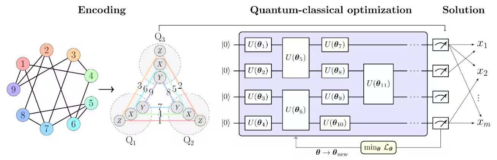

# Project Design

## 1. Problem definition

The project studies the permutation flow-shop scheduling problem. There are $n$ jobs and $m$ machines. Every job visits the machines in the same order, from machine 1 to machine $m$, and each machine can process at most one job at a time. Processing job $j$ on machine $k$ takes $p_{j,k}$ time units.

The main objective is to minimize the makespan $C_{\max}$, defined as the time when all jobs have finished processing on the final machine. The baseline assumes that all jobs are available at time zero, processing is non-preemptive, processing times are known and fixed, machines do not fail, and jobs may wait between machines. There are no release dates, due dates, sequence-dependent setup times, blocking constraints, or alternative machine assignments in the current baseline.

Let $\pi=(\pi_1,\ldots,\pi_n)$ be a job permutation. For a fixed permutation, completion times are computed by

$$
C_{i,k}=p_{\pi_i,k}+\max(C_{i-1,k},C_{i,k-1}),
$$

with $C_{0,k}=C_{i,0}=0$. The makespan is $C_{\max}=C_{n,m}$. This recurrence is also used to evaluate decoded QAOA/PCE schedules independently of their QUBO energy. There are $n!$ possible job orders. The challenge is selecting an order with a small makespan.

## 2. Data model

The processing-time matrix is $p\in\mathbb{R}_{\geq0}^{n\times m}$, stored in Python as `p[j][k]`: row `j` identifies a job and column `k` identifies a machine. Mathematical notation in this document is one-based. 

The main benchmark sizes currently covered are the mandatory 2-job × 2-machine and 3-job × 3-machine baselines, an OR-Tools flow-shop instance with 11 jobs and 5 machines, and Taillard instances including 20 jobs and 5 machines. Exact instance data and identifiers should be kept alongside each reported result so all three solvers evaluate the same input.

## 3. Classical reference model

`1_cp_sat.py` uses PyJobShop / OR-Tools as the classical scheduling reference.

Every candidate sequence from a quantum method is evaluated using the gap definition used. The gap to a lower bound is

$$
\text{gap}_{LB}=100\,\frac{C_{\max}-LB}{LB}\%,
$$

where $LB$ is the stated lower bound. This is not an optimality gap unless the bound is known to equal the optimum.

## 4. Position-based QUBO: QAOA and the QUBO used by PCE

### 4.1 Binary assignment variables

The position-based encoding uses $n^2$ binary variables:

$$
x_{i,j}=\begin{cases}1,&\text{if job }j\text{ occupies position }i,\\0,&\text{otherwise.}\end{cases}
$$

A feasible solution is a permutation matrix. Each position must contain one job, and each job must occur in one position:

$$
\sum_{j=1}^{n}x_{i,j}=1\quad\forall i,
\qquad
\sum_{i=1}^{n}x_{i,j}=1\quad\forall j.
$$

These constraints ensure that a decoded assignment neither duplicates nor omits a job. They are the same assignment constraints for both quantum approaches.

### 4.2 Constraint penalties

The equalities are converted into squared penalties:

$$
\begin{aligned}
E_{\mathrm{constraints}}(x)={}&
\sum_{i=1}^{n}\left(\sum_{j=1}^{n}x_{i,j}-1\right)^2\\
&+\sum_{j=1}^{n}\left(\sum_{i=1}^{n}x_{i,j}-1\right)^2.
\end{aligned}
$$

This penalty is zero exactly when all row and column constraints hold.

### 4.3 Approximate scheduling cost

The current baseline retains the approximate position-based cost used in the prototype:
$$
E_{\mathrm{cost}}(x)
=
\sum_{k=1}^{m-1}\sum_{i=1}^{n-1}
\left(
\sum_{j=1}^{n} p_{j,k}x_{i+1,j}
-
\sum_{j=1}^{n} p_{j,k+1}x_{i,j}
\right).
$$

This is the cost as implemented in the current model, with the natural index ranges that keep $i+1$ and $k+1$ valid. In this expression, processing times multiply individual assignment variables, so the cost contributes linear coefficients. The quadratic terms in the current QUBO come from the permutation penalties.

The complete energy minimized by the prototype is

$$
E(x)=P E_{\mathrm{constraints}}(x)+E_{\mathrm{cost}}(x)
$$

with penalty scale

$$
P=A\sum_{j=1}^{n}\sum_{k=1}^{m}p_{j,k}.
$$

The initial prototype uses $A=10$. This is a heuristic scale based on total processing time/

### 4.4 Important limitation of this QUBO

The above cost is an approximation, not an exact algebraic encoding of the flow-shop makespan. A minimum-energy QUBO assignment need not minimize the actual makespan. The formulation was retained as the baseline because it is compact, position-based, and useful for a controlled study of QAOA and PCE. A future exact makespan QUBO would require a different or extended encoding and a separate variable-count and correctness analysis.

## 5. QAOA solver

The QAOA implementation optimizes the position-based QUBO using a parameterized quantum circuit and a Conditional Value at Risk (CVaR) objective. Because QAOA uses the same approximate QUBO, a lower sampled energy is not by itself evidence of a lower makespan. The Gantt chart and makespan calculation are evaluation outputs.

## 6. Pauli Correlation Encoding and PAGD

### 6.1 Qubit-efficient encoding

PCE maps logical QUBO variables to expectation values of two-body Pauli correlations. The implementation uses the available $XX$, $YY$, and $ZZ$ correlators over qubit pairs. With $q$ qubits, the available two-body correlation count is

$$
3\binom{q}{2}=\frac{3q(q-1)}{2}.
$$
The smallest qubit count used by the encoding is the least integer $q$ satisfying

$$
3\binom{q}{2}\ge n^2.
$$

### 6.2 QUBO-space training loss

Let $e_i\in[-1,1]$ be the PCE expectation value for logical variable $i$. The soft binary value is

$$
\tilde{x}_i=\sigma(-\alpha e_i)=\frac{1}{1+\exp(\alpha e_i)},
$$

and the training objective is

$$
\mathcal{L}_{\mathrm{QUBO}}=\tilde{x}^{\mathsf T}Q\tilde{x}.
$$

The scale $\alpha$ controls the sharpness of the soft-binary mapping. Optimization is performed with COBYLA. The loss is a continuous training objective.

### 6.3 Permutation-aware PAGD decoder

After training, PAGD combines a QUBO marginal-energy estimate with the PCE prior. For a symmetric $Q$, the exact energy change from switching an inactive bit $x_a$ to 1, with all current active bits held fixed, is

$$
\Delta_a=Q_{aa}+2\sum_{b:x_b=1}Q_{ab}.
$$

The prior is $\rho_a=\sigma(-\alpha e_a)$, and a candidate with $\Delta_a<0$ is scored as

$$
s_a=(-\Delta_a)\rho_a^\beta.
$$

The permutation-specific decoder changes the original PAGD pruning rule to fit assignment constraints. It selects only an eligible pair $(i,j)$ whose position and job are both unused, then removes all other candidates in row $i$ and column $j$. It continues until all positions and jobs have been assigned. If no eligible candidate has negative marginal energy, a completion step chooses an available candidate with the smallest marginal cost, using the prior to break ties.

## 7. Feasibility and correctness checks

For the baseline, feasibility has two levels:

1. **Assignment feasibility:** every row and every column of $X$ sums to one. This is guaranteed by a complete permutation-aware decoding, and encouraged in the QUBO through squared penalties.
2. **Scheduling feasibility:** a job sequence is scheduled on each machine in the common machine order, without processing overlap on a machine and without a job starting on machine $k+1$ before finishing machine $k$. The completion-time recurrence constructs such a schedule under the baseline assumptions.

## 8. Scope of the model and proposed extension work

The implemented model covers permutation flow-shop scheduling with fixed processing times. It does not yet model due dates and tardiness, sequence-dependent setups, etc. Future work involve presenting a QUBO formulation which can handle these constraints better.

## References

1. Y. Farhani, M. Saiem, T. Arbaoui, and F. Hnaien, “Enhanced QUBO Formulations for The Flow Shop Scheduling Problem,” *Proceedings of the Genetic and Evolutionary Computation Conference Companion (GECCO ’24 Companion)*, 2024, pp. 1942–1949. [https://doi.org/10.1145/3638530.3664150](https://doi.org/10.1145/3638530.3664150). The paper compares a position-based formulation with TSP-based approximations for permutation flow-shop scheduling.
2. M. Šeda, “Mathematical Models of Flow Shop and Job Shop Scheduling Problems,” 2007. [Publication record](https://doi.org/10.5281/zenodo.1082307). This work discusses mathematical models for flow-shop and job-shop scheduling and is cited as background for the scheduling formulation.
3. M. Sciorilli, L. Borges, T. L. Patti, D. García-Martín, G. Camilo, A. Anandkumar, and L. Aolita, “Towards large-scale quantum optimization solvers with few qubits,” *Nature Communications*, vol. 16, article 476, 2025. [https://doi.org/10.1038/s41467-024-55346-z](https://doi.org/10.1038/s41467-024-55346-z). This paper introduces Pauli Correlation Encoding (PCE).
4. T. Friedhoff, M. Metkar, W. Davis, V. Kumar, and A. Galda, “Pauli Correlation Encoding for mRNA Secondary Structure Prediction: Problem-Aware Decoding for Dense-Constraint QUBOs,” arXiv:2605.20163, 2026. [https://arxiv.org/abs/2605.20163](https://arxiv.org/abs/2605.20163). This paper introduces the Problem-Aware Guided Decoder (PAGD) and QUBO-space sigmoid training loss that motivate the adapted PCE post-processing pipeline.
5. IBM Quantum, “Pauli correlation encoding to reduce max-cut requirements,” Qiskit documentation tutorial. [https://qiskit.qotlabs.org/docs/tutorials/pauli-correlation-encoding-for-qaoa](https://qiskit.qotlabs.org/docs/tutorials/pauli-correlation-encoding-for-qaoa). This tutorial was used as an implementation reference for two-body Pauli-correlation encoding and the `efficient_su2` simulator workflow.
